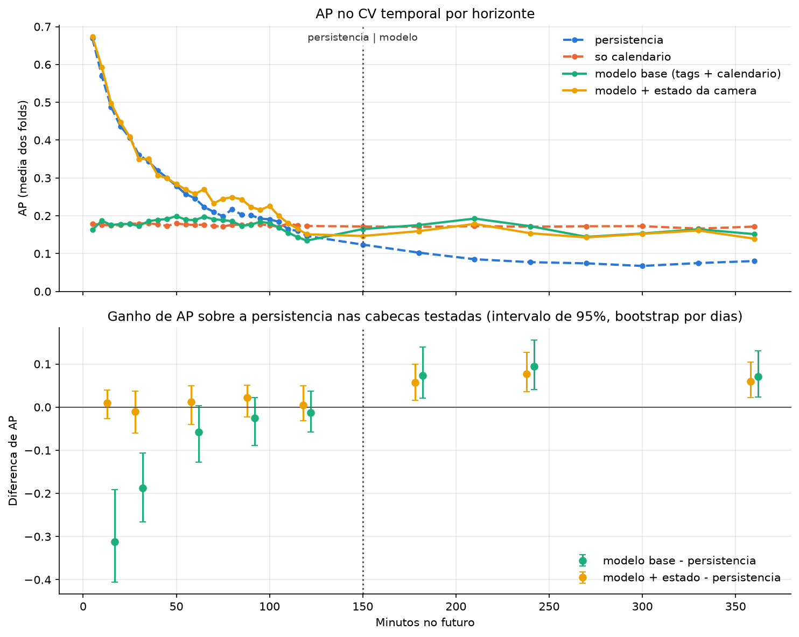

# Escolha dos horizontes (cabecas) do modelo

Gerado por notebooks/3.0-jm-escolha-horizontes.ipynb em 2026-10-16 11:04:37

- Periodo de treino: 2026-08-20 14:15:00 ate 2026-10-02 23:10:00
- Hold out: 2026-10-02 23:15:00 ate 2026-10-13 08:30:00
- Dias removidos: ['2026-09-15', '2026-09-16']
- Modelo: create_model() (LightGBM) do train.py
- Modelo vence o calendario (Holm): [15, 30]
- Modelo vence persistencia e calendario (Holm): []
- Features do modelo base: ['306-AIT-004-2', '306-AIT-004-5', '306FE002-AI001-R', '406-AI-004-2', '406-AI-004-4', '406-AIT-001', 'Hora', 'Minuto', 'Dia_Semana']
- Estado da camera: ['score_atual', 'score_max_30']

## Regra

- Metrica: AP (average precision) por fold do CV temporal (so periodo de treino), media dos folds.
- Referencias: persistencia (score da camera agora) e modelo so com o calendario.
- Teste: bootstrap pareado por dias dentro de cada fold, p-valor unilateral, Holm nas cabecas testadas.
- Indicadora: em cada cabeca, usa o modelo so se ele vence a persistencia (p de Holm < 0,05); se nao, usa a persistencia.

## Resultado: previsor por cabeca (PREVISOR_POR_CABECA)

- 15 min: persistencia
- 30 min: persistencia
- 60 min: persistencia
- 90 min: persistencia
- 120 min: persistencia
- 180 min: base_estado
- 240 min: base_estado
- 360 min: base_estado

## CV temporal (treino)

```
 minutos  ap_persistencia  ap_calendario  ap_base  ap_base_estado  dif_calendario_vs_persistencia  p_calendario_vs_persistencia  dif_base_vs_persistencia  p_base_vs_persistencia  dif_base_vs_calendario  p_base_vs_calendario  dif_base_estado_vs_persistencia  p_base_estado_vs_persistencia  dif_base_estado_vs_calendario  p_base_estado_vs_calendario
      15            0.488          0.174    0.176           0.498                          -0.314                         1.000                    -0.312                   1.000                   0.001                 0.577                            0.010                          0.330                          0.324                        0.001
      30            0.360          0.179    0.173           0.350                          -0.181                         1.000                    -0.187                   1.000                  -0.006                 0.668                           -0.010                          0.685                          0.171                        0.001
      60            0.246          0.176    0.189           0.258                          -0.070                         0.938                    -0.057                   0.967                   0.013                 0.374                            0.012                          0.349                          0.082                        0.027
      90            0.201          0.178    0.177           0.224                          -0.024                         0.694                    -0.025                   0.836                  -0.001                 0.618                            0.022                          0.201                          0.046                        0.110
     120            0.147          0.173    0.134           0.151                           0.026                         0.225                    -0.012                   0.582                  -0.038                 0.864                            0.004                          0.292                         -0.022                        0.676
     180            0.103          0.171    0.175           0.159                           0.068                         0.018                     0.073                   0.002                   0.005                 0.373                            0.057                          0.003                         -0.011                        0.673
     240            0.077          0.171    0.172           0.154                           0.094                         0.001                     0.095                   0.001                   0.001                 0.434                            0.076                          0.001                         -0.017                        0.657
     360            0.080          0.171    0.151           0.140                           0.091                         0.003                     0.071                   0.002                  -0.020                 0.813                            0.059                          0.002                         -0.032                        0.908
```

## Hold out (teste, usado uma vez so)

```
 minutos  prevalencia_teste  ap_teste_persistencia  ap_teste_calendario  ic_inf_calendario_vs_persistencia  ic_sup_calendario_vs_persistencia  ap_teste_base  ic_inf_base_vs_persistencia  ic_sup_base_vs_persistencia  ap_teste_base_estado  ic_inf_base_estado_vs_persistencia  ic_sup_base_estado_vs_persistencia
      15              0.123                  0.721                0.504                             -0.390                             -0.049          0.525                       -0.299                       -0.055                 0.786                               0.024                               0.103
      30              0.124                  0.632                0.489                             -0.326                              0.037          0.493                       -0.264                       -0.023                 0.724                               0.040                               0.149
      60              0.124                  0.471                0.520                             -0.148                              0.244          0.531                       -0.127                        0.198                 0.597                               0.057                               0.177
      90              0.125                  0.368                0.505                             -0.037                              0.287          0.493                       -0.022                        0.224                 0.489                               0.069                               0.165
     120              0.125                  0.323                0.526                              0.003                              0.375          0.461                       -0.088                        0.350                 0.462                               0.020                               0.213
     180              0.126                  0.266                0.521                              0.030                              0.410          0.382                       -0.074                        0.319                 0.400                              -0.053                               0.286
     240              0.126                  0.240                0.530                              0.051                              0.428          0.354                       -0.023                        0.250                 0.351                              -0.047                               0.266
     360              0.128                  0.164                0.527                              0.105                              0.521          0.527                        0.116                        0.442                 0.462                               0.094                               0.404
```


